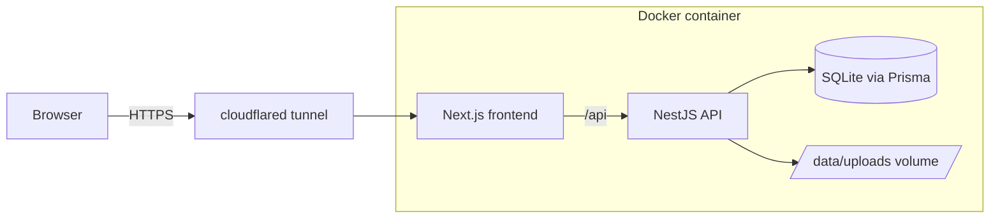

# RV Files

RV Files is a hackathon file-sharing service (PS2). Owners upload files and share them by link. Links can expire, be password-protected, have a view limit, or be revoked. Nothing a user uploads is allowed to harm the service or the people who open the link. It is a hardened fork of Pingvin Share X (see Credits).

**Live demo:** the team shares the current tunnel URL at judging time (it changes when the tunnel restarts).

**Demo in 60 seconds**
1. Open the live demo URL, register an account, and log in.
2. Upload a file (10 MB max per share), set an expiry (max 7 days), optionally a password and a view limit, and create the share.
3. Open the link in a private window. The recipient page shows a safety card (who shared it, file type and size, checks performed, a live expiry countdown, views left, password badge). Download the file.
4. Back on the dashboard, see the download counter and the activity log. Click Revoke, then reload the link: the recipient sees "revoked by owner".

## Architecture



The browser talks only to the tunnel. The Next.js frontend serves the pages and proxies API calls to the NestJS backend. The backend stores metadata in SQLite and file chunks on local disk under the mounted data volume. Every upload chunk goes through the server, so quota and size checks cannot be bypassed.

## PS2 answers

### 1. Who are your users, what can they do, and what is out of scope?
There are three roles. An owner registers, logs in, uploads files, creates shares, and sees a dashboard with views, downloads and an activity log; the owner can revoke, expire or delete a share. A recipient is anyone with the link: no account is needed, but they may need the share password. An admin (the first seeded account) sets global limits and can disable registration. Out of scope: end-to-end encryption, reverse shares (left as-is, not demoed), email/SMTP, OIDC/LDAP, and a mobile app. The full design is in `docs/superpowers/specs/2026-10-28-ps2-file-sharing-design.md`.

### 2. What are your file rules (types, size, quota, expiry, limits)?
A share may hold at most 10 MB. Each user has a 50 MB default storage quota (config `share.defaultStorageQuota`). Expiry defaults to 1 day and is capped at 7 days. Files with these extensions are rejected: exe, bat, cmd, sh, ps1, js, html, htm, svg, xhtml, msi, scr, jar, apk, dll, plus dotfiles such as `.htaccess`. Every extension in the file name is checked, so `report.html.txt` is blocked. The rules live in `backend/src/utils/fileNamePolicy.util.ts`, `backend/src/utils/fileSize.util.ts` and `backend/src/utils/storageQuota.util.ts`.

### 3. What do your architecture and upload/download flow look like, and why?
See the diagram above. We forked Pingvin Share X because it already had accounts, quota, expiring shares, password links and safe download headers, which left our time for closing the rubric gaps. Upload: the owner creates a share (the server picks the ID), then the browser sends the file in chunks to `backend/src/file/file.controller.ts`. `backend/src/file/file.service.ts` rejects blocked file names on chunk 0 and on the pre-signed init (`isBlockedFileName` in `backend/src/utils/fileNamePolicy.util.ts`), and `backend/src/file/local.service.ts` checks the 10 MB share limit (`share.maxSize`, default in `backend/prisma/seed/config.seed.ts`) and the quota (`resolveStorageQuota` in `backend/src/utils/storageQuota.util.ts`) before the chunk is written to disk. Download: the recipient opens the link, `backend/src/share/share.service.ts` checks that the share exists, is not expired or revoked, has views left, and that the password matches, and then the file controller streams the file with safe headers. S3 presigned direct uploads are disabled so no chunk can skip the server checks; storage is local disk.

### 4. Where do files and metadata live, and do they survive a restart?
Metadata (users, shares, access events) is in a SQLite database and the files are on local disk, both inside `./data`, which Docker maps to `/opt/app/backend/data` (see `docker-compose.local.yml`). Because that is a host-mounted folder, the database and uploads survive `docker compose restart` and a full container rebuild. Only deleting `./data` removes them. Expired and revoked shares stop being served, and the existing Pingvin cleanup job removes expired shares and their files.

### 5. How are share links made unguessable, and how is access enforced?
The server generates every share ID with `crypto.randomBytes(16)` encoded as base64url: 22 characters, 128 bits of entropy (`backend/src/utils/shareId.util.ts`). Any ID supplied by the client is ignored, so users cannot choose guessable links. Access is enforced on the server for every request: an existence check, then expiry, revoked state, view limit and password, each with its own recipient message (not found / expired / revoked / view limit / wrong password). Owner actions (revoke, delete, activity log) require the owner's login and ownership of that share. Wrong-password attempts are rate-limited and feed the tripwire described in answer 9.

### 6. Does the full upload, share and download flow work end to end?
Yes. Register, upload, create the share, open the link as a recipient, and download all work on the live demo, and the dashboard then shows the download count. The integration tests in `backend/test/integration/*.test.mjs` exercise the flow over HTTP: server-generated IDs, file safety and size limits, and revoke plus the distinct link states. `scripts/attack-demo.sh` runs the whole abuse scenario against a live instance (see "Run the attack demo"). Any judge can repeat the steps in the demo section above.

### 7. Can a malicious file hurt your service or your users?
We assume it cannot, for these reasons. Dangerous extensions are blocked on upload, but that blocklist is only defence in depth; safe serving is the real guard. Every file response carries `X-Content-Type-Options: nosniff` and `Content-Security-Policy: sandbox; default-src 'none'; img-src 'self'; media-src 'self'`, and is sent as an attachment (only passive media such as images, audio and video may be previewed inline). So even an HTML or SVG file that got through could not run script in our origin. File names are sanitised before they touch the disk. ClamAV is not deployed on the demo because it needs about 1 GB of RAM; Pingvin's built-in ClamAV integration (`backend/src/clamscan/clamscan.service.ts`) can be enabled locally by running a ClamAV container and turning on the ClamAV setting in the admin config.

### 8. Are size, quota and expiry limits enforced by the server?
Yes, all three are checked on the server, never only in the browser. Size and quota are checked in the upload path in `backend/src/file/local.service.ts` (quota via `resolveStorageQuota`, with `backend/src/share/share.service.ts` also applying it at share creation; default 50 MB in `backend/prisma/seed/config.seed.ts`). The expiry cap (`share.maxExpiration`, 7 days) is enforced in `backend/src/share/share.service.ts`. Oversized files, a quota overflow and an expiry beyond 7 days are rejected regardless of what the client sends. Revoking or expiring a share frees its quota, because the quota utility counts only active shares. One honest limitation: the quota check reads the current usage and then writes, so it is not atomic and two truly simultaneous uploads could slightly exceed the quota. The 10 MB per-share cap is still enforced per share.

### 9. Can someone access or abuse what isn't theirs?
Guessing links is infeasible (128-bit IDs). Other users' shares cannot be revoked, deleted or read in the dashboard because the owner guards check ownership. Access events are recorded and the tripwire runs in `backend/src/share/accessEvent.service.ts`; the tripwire rules are in `backend/src/utils/tripwire.util.ts`, and the guessable endpoints (share ID availability and share token) are rate-limited with `@Throttle` in `backend/src/share/share.controller.ts`. The tripwire auto-revokes a share on 5 or more wrong passwords within 10 minutes ("Auto-revoked: too many wrong passwords") or on 20 or more downloads from 5 or more distinct IPs within 10 minutes ("Auto-revoked: unusual download activity"). IP addresses are stored only as `sha256(ip + secret)`, never in clear. The owner sees every access event in the activity log. Open sign-up is a risk: roughly ten full accounts could fill the disk, so the admin can disable registration.

### 10. Is it deployed, and can someone else run, test and understand it?
It is deployed from a laptop: Railway sign-ups were disabled, so `docker compose -f docker-compose.local.yml up --build -d` runs the app and `cloudflared tunnel --url http://localhost:3001` publishes it at a quick-tunnel URL that changes on restart. The laptop must stay awake; the container config also works on Railway as a fallback. Anyone can run it with the steps below, run unit tests with `cd backend && npm run test:unit`, and run the attack demo. This README and the design doc explain every decision.

## Run it yourself

```bash
docker compose -f docker-compose.local.yml up --build -d   # app on http://localhost:3001, data in ./data
cloudflared tunnel --url http://localhost:3001             # optional: public URL
BASE_URL=http://localhost:3001 ./scripts/attack-demo.sh    # attack demo
```

The first account you register becomes the admin. Tests: `cd backend && npm run test:unit` (unit) and the files in `backend/test/integration/*.test.mjs` (integration, run against a running instance).

## Run the attack demo

```bash
BASE_URL=http://localhost:3001 ./scripts/attack-demo.sh
FAST=1 BASE_URL=http://localhost:3001 ./scripts/attack-demo.sh   # skips the 65 s expiry wait
```

It tries each abuse (blocked extensions, oversize, quota overflow, guessed IDs, wrong passwords, expiry, revoke, someone else's share) and prints whether the server blocked it.

## Credits

RV Files is built on [Pingvin Share](https://github.com/stonith404/pingvin-share) by stonith404 and [Pingvin Share X](https://github.com/smp46/pingvin-share-x) by smp46. The BSD-2 licence is kept (see `LICENSE`).

---

# Upstream: Pingvin Share X

Pingvin Share X is a fork of [Pingvin Share](https://github.com/stonith404/pingvin-share), a self-hosted file sharing platform and an alternative for WeTransfer.

## Features

- Share files using a link
- Unlimited file size (restricted only by disk space)
- Set an expiration date for shares
- Secure shares with visitor limits and passwords
- Email recipients
- Reverse shares
- OIDC and LDAP authentication
- Integration with ClamAV for security scans
- Different file providers: local storage and S3

## Setup

### Installation with Docker (recommended)

1. Download the `docker-compose.yml` file
2. Run `docker compose up -d`

The website is now listening on `http://localhost:3000`.

> [!TIP]
> Checkout [stonith404/Pocket ID](https://github.com/stonith404/pocket-id), a user-friendly OIDC provider that lets you easily log in to services like Pingvin Share X using Passkeys. Made by the original creator of Pingvin Share.

### Beta Channel (Testing)

Pingvin Share X now has a beta, this is where all (non-time sensitive) bug fixes, features and other updates will go before reaching stable.

To use the Beta channel:
1. Update the container image tag in your `docker-compose.yml` to `:beta`:
   ```yaml
   image: smp46/pingvin-share-x:beta
   # or ghcr.io/smp46/pingvin-share-x:beta
   ```
2. Pull the latest beta image and recreate the container:
   ```bash
   docker compose pull
   docker compose up -d
   ```

> [!IMPORTANT]
> If you encounter any bugs, regressions, or have any other feedback while running the beta version, please [open a GitHub Issue](https://github.com/smp46/pingvin-share-x/issues). Please ensure you specify the exact version (including the beta tag).

### Alternative Deployments

Pingvin Share X can also be deployed through other platforms. For more information, see the [documentation](https://smp46.github.io/pingvin-share-x/setup/installation#alternative-deployments).

## Documentation

For more installation options and advanced configurations, please refer to the [documentation](https://smp46.github.io/pingvin-share-x/).

## Sponsors

If you find Pingvin Share X useful and would like to support its ongoing development and maintenance please consider becoming a sponsor! 

I would like to host a demo instance online for people to try out Pingvin, your sponsorship would make this possible.

As a token of appreciation, sponsors can have their profile or company logo displayed right here in this section.

### Our Awesome Sponsors

| <a href="https://github.com/sponsors/smp46"><br /><sub><b>Your Name Here</b></sub></a> |
| :---: |

💖 Support the project via [GitHub Sponsors](https://github.com/sponsors/smp46)

## Contributing

All contributions are welcome, including issues, feature suggestions, pull requests and *translations*.

### Translations

This project supports 34 languages so far, an LLM is used to add most translations, 
but you can help correct these or add more at [CrowdIn](https://crowdin.com/project/pingvin-share-x).

### AI Usage Policy

Anyone submitting code to this repo needs to read and comply with the project's [AI Usage Policy](https://github.com/smp46/pingvin-share-x/blob/main/AI_USAGE_POLICY.md). AI-generated code is welcome, but you need to understand it and explain it in your own words. Please respect the time of maintainers, submissions that do not comply will be closed.

### Getting started

If you have found a bug, have a suggestion or something else, please open an issue.

### Submit a Pull Request

Before you submit the pull request for review please ensure that

- The pull request naming follows the [Conventional Commits specification](https://www.conventionalcommits.org):

  `<type>[optional scope]: <description>`

  example:

  ```
  feat(share): add password protection
  ```

  When `TYPE` can be:
  - **feat** - is a new feature
  - **doc** - documentation only changes
  - **fix** - a bug fix
  - **refactor** - code change that neither fixes a bug nor adds a feature

- Your pull request has a detailed description, written by you
- You run `npm run format` to format the code

### Setup project

#### Backend

1. Open the `backend` folder
2. Install the dependencies with `npm install`
3. Push the database schema to the database by running `npx prisma db push`
4. Seed the database with `npx prisma db seed`
5. Start the backend with `npm run dev`

#### Frontend

1. Start the backend first
2. Open the `frontend` folder
3. Install the dependencies with `npm install`
4. Start the frontend with `npm run dev`

You're all set!

#### Testing

At the moment we only have system tests for the backend. To run these tests, run `npm run test:system` in the backend folder.
